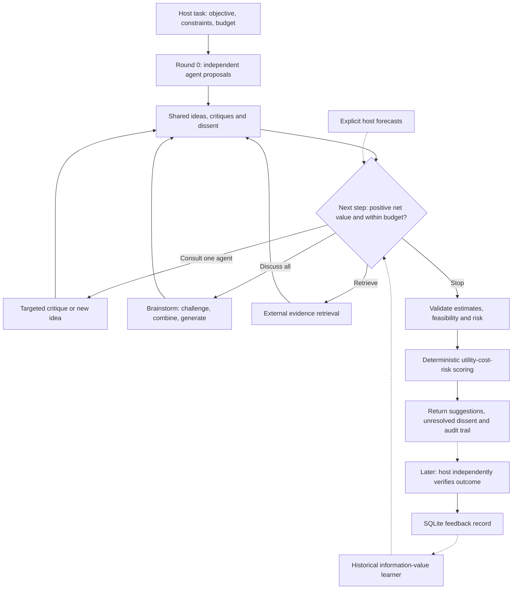
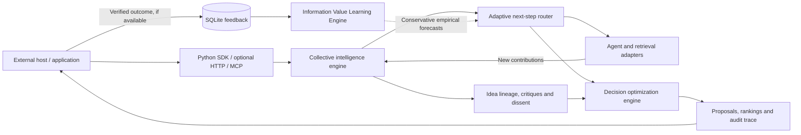

# PluralForge AI

**Many minds. New ideas. Better decisions.**  
**Cost-Aware Collective Intelligence & Decision Optimization**  
**成本感知的集体智能与决策优化**


> **PluralForge AI** is an open-source, domain-neutral decision layer for multi-agent systems. Agents think independently, challenge each other, **create new candidate solutions**, and **preserve dissent**. A transparent scoring engine and a cost-aware router help the host decide whether to consult another agent, discuss further, retrieve evidence, or stop. No all-powerful meta-judge. No automatic execution of real-world actions.
>
> **中文简介：** PluralForge AI 是通用、可插拔的多智能体协作决策框架。多个 Agent 先独立思考，再交叉质疑、组合创新方案、保留不同意见；系统根据预期信息价值、预算、风险和效用决定继续咨询、讨论、检索还是停止。它不是多数投票工具，也不由单个元裁判拍板。

**Release / 版本：** v0.7 research MVP · Python 3.11+ · MIT · offline-first  
**Interfaces / 接口：** Python SDK · optional local REST API · optional MCP · optional LiteLLM  
**Compatibility / 兼容性：** import from `pluralforge` (preferred); `arbiter_plugin` is retained for older applications.

**Quick links / 快速导航：** [Workflow / 业务流程](#workflow--业务流程) · [Architecture / 技术架构](#architecture--技术架构) · [Installation](#installation) · [Information Value Learning](#information-value-learning-engine--new-v05) · [Shared Environment](docs/SHARED_ENVIRONMENT.md) · [Benchmarks](#benchmarks-and-scientific-claims) · [中文快速开始](#中文快速开始)

## Why this exists

More model calls and longer debates do **not** necessarily produce better answers. PluralForge treats deliberation as an **investment decision**: compare the *expected improvement* of each available next step against its cost, while respecting the remaining API budget. It does **not** force consensus or presume the extra calls will help.

## Workflow / 业务流程

The process optimizes **decision quality per unit of cost**, not agreement among agents. **A new idea can be generated mid-discussion, and opposing agents may remain opposed at the end.**  
**业务逻辑：** 用户定义任务与约束 → 各 Agent 独立提出方案 → 多轮质疑、生成新方案并保留分歧 → 根据预期信息收益和预算选择下一步 → 完整性与风险检查 → 独立评分 → 输出建议和可审核轨迹 → 在有外部核验结果后学习。



**Decision boundaries / 决策边界：**

- **No forced consensus / 不强制共识：** opposition and minority positions are retained as structured data.
- **No judge override / 不让元裁判拍板：** LLM critiques are inputs, not an authorization or final verdict.
- **Incomplete estimates / 估值缺失：** options missing comparable utility, cost, risk or feasibility remain unscored; the system may return `needs_estimates`.
- **Risk and review / 风险与人工审核：** warnings or review policies may return `needs_review`; the system never directly performs consequential actions.
- **No invented VoI / 不编造信息价值：** without adequate verified history or explicit host forecasts, the learner abstains and the router can stop.

## Architecture / 技术架构

The core engine does not depend on any specific model provider or business domain. The app or host supplies task-specific scoring rules, agent adapters and independently verified outcomes.  
**核心是通用插件：** Agent、行业数据和评分标准由外部应用提供；插件负责协作记录、下一步路由、确定性评分和基于核验反馈的经验估计。



**Math in one line / 核心公式：** `net_utility = expected_utility - execution_cost - risk_aversion * risk_loss`. All three quantities must use a comparable **utility unit**. API usage cost is tracked in **USD separately**, as a spending constraint; the engine does not subtract USD from utility points.

**Implementation map / 代码位置：** `arbiter_plugin/collaboration.py` handles proposals, dissent and scoring; `adaptive.py` routes the next step; `value_learning.py` learns from verified history; `feedback.py` saves outcomes; `api.py` and `mcp_server.py` expose optional integration points. `pluralforge/` provides the preferred import path.

### What is in v0.6

| Component | What it actually does | Important boundary |
|---|---|---|
| Independent brainstorming | Async agents propose separately before reading peers | External model calls require explicit setup |
| Collaborative proposals | Agents critique, revise, combine and introduce new idea IDs with provenance | IDs alone do not establish semantic novelty |
| Preserve dissent | Store support, opposition, and full discussion traces | Consensus is not a success metric |
| Adaptive action routing | Select `consult_agent`, `discuss_all`, `retrieve`, or `stop` by estimated **net information value** and reservations | Forecast inputs can be host supplied or estimated from sparse, verified historical observations; causal effects remain unproven |
| Novelty hints | Surface-form similarity warnings, no forced merging | Not semantic embedding-based deduplication |
| Decision scoring | `expected_utility - execution_cost - risk_aversion * risk_loss` | Missing estimates block final selection; all in the same utility unit |
| Audit and feedback | SQLite host-attested outcome records and provenance | Evidence must be externally verified; no auto-retraining |
| **Information Value Learning Engine (v0.5)** | Learns regularized per-action marginal gain and costs from evidence-attributed historical outcomes, with time-cutoff checks and abstention | Observational predictor only; **not causal VoI**, no learned hard spend cap |
| Policy comparison | Scripted cross-domain cases comparing single agent, voting, fixed discussion and adaptive routing | Synthetic illustrations **are not real LLM benchmark results** |
| Interfaces | Python SDK, optional local HTTP and MCP tools | MCP handshake and paid model integrations require environment-specific testing |
| **Shared Blackboard (v0.6)** | SQLite-scoped shared state, event history, durable subscriptions and bounded dispatch | Host must invoke workers; no automatic tool execution or authentication |
| **Code references (v0.6)** | Store branch/commit/hash metadata as inert artifacts | No code execution, sandboxing or automatic merging |

## Shared environment / 共享环境 · v0.6

The optional shared blackboard lets multiple agents observe **persistent changes** rather than repeatedly exchanging entire discussion transcripts. SQLite stores versioned artifacts, append-only events and per-consumer checkpoints. An agent may record proposals, external-environment observations, experiment reports and references to code commits; another agent subscribes to the relevant event type and produces a critique or new hypothesis.

The new API is `SharedBlackboard`, `EventWorker` and `VersionConflict` from `pluralforge`. It is additive: the existing `run_brainstorm` behavior and its independent first round do not change. Workers only run when explicitly invoked by a host, and all generated claims begin unverified. Code references are never executed by this module.

Run the offline event-driven example: `python -m examples.blackboard_demo`.

Full design, usage, caveats and v0.7 roadmap: [Shared Environment / 共享环境](docs/SHARED_ENVIRONMENT.md).

## Controlled experiment runner / 隔离代码实验 · v0.7

Opt-in `DockerExperimentRunner` executes host-approved benchmark scripts with candidate Python code in a constrained Docker container (network disabled, read-only mounts, non-root user, bounded resources). `record_experiment` writes metrics to the shared blackboard and emits `benchmark.completed` for critic agents. Results are initially unverified, and no agent is authorized to merge code or deploy changes.

**Requires a trusted host, a reviewed benchmark, a separately installed Docker engine, and dedicated runtime isolation for adversarial workloads.** The runner is not an autonomous agent, an automatic benchmark-authoring system, or a guarantee against container escapes. See [Experiment runner / 实验执行器](docs/EXPERIMENTS.md).

## Installation

```powershell
# Windows / VS Code, from repository root
py -3.12 -m venv .venv
.venv\Scripts\Activate.ps1
python -m pip install -e ".[dev]"

python -m examples.adaptive_demo
python -m examples.value_learning_demo
python -m benchmarks.learning_temporal_replay
python -m examples.collaborative_demo
python -m examples.blackboard_demo
python -m benchmarks.compare_policies
python -m pytest
```

For Linux/macOS use `python3 -m venv .venv && source .venv/bin/activate`. None of the commands above make paid model calls.

### GitHub Pages demonstration

Open [`docs/index.html`](docs/index.html) directly in a browser, or publish `/docs` through **Settings → Pages**. The offline webpage illustrates discussion rounds, disagreement, utility scoring and routing; it does not call a remote model.

## One function: should we keep thinking?

```python
from pluralforge import NextActionEstimate, select_next_action

candidates = [
    NextActionEstimate(
        action="consult_agent", agent_id="critic",
        expected_decision_gain=8, execution_cost_utility=2,
        estimated_api_cost_usd=0.02,
        rationale="Host estimates a targeted critique may reveal failure modes",
    ),
    NextActionEstimate(
        action="discuss_all",
        expected_decision_gain=7, execution_cost_utility=5,
        estimated_api_cost_usd=0.08,
        rationale="Full second discussion round",
    ),
]

plan = select_next_action(
    candidates,
    remaining_api_budget_usd=0.05,
    reservations_usd={"critic": 0.02, "builder": 0.03},
)
print(plan.action, plan.agent_id)  # consult_agent critic
```

`expected_decision_gain` and `execution_cost_utility` are in **the same decision utility unit** (e.g., calibrated points). API costs and reservations are measured separately in **USD**; the router does not subtract USD directly from abstract points. The `rationale` should record the origin of the forecast. The router filters unaffordable and unavailable actions and chooses the highest positive net value. If no action qualifies, it recommends `stop`.

**The deterministic router accepts explicit host forecasts, and v0.5 can also supply empirical forecasts from earlier host-verified observations.** These observational estimates are not proven causal value of information. Forecast calibration remains an open research challenge. Preflight spending reservations cannot enforce provider billing limits.

## Information Value Learning Engine · NEW v0.5

When the host supplies verified feedback, PluralForge can learn which consultation, extra discussion or retrieval action **historically improved a comparable decision-quality rubric** in the same domain and context. It keeps execution cost (utility points) separate from API spend (USD), requires a minimum amount of past feedback, and **abstains** without sufficient evidence or an explicitly declared host prior.

```python
from datetime import datetime, timezone
from pluralforge import (LearningContext, ActionCandidate, LearningRequest,
                         InformationValueLearner)

learner = InformationValueLearner('local_value_feedback.sqlite')
request = LearningRequest(
    context=LearningContext(domain='software', utility_unit='points',
                            tags={'task': 'architecture'}),
    candidates=[ActionCandidate(action='consult_agent', agent_id='critic'),
                ActionCandidate(action='retrieve')],
    as_of=datetime.now(timezone.utc),
)
report = learner.forecast(request)
print([(r.action, r.source) for r in report.forecasts])
# New databases return insufficient_data; they DO NOT invent forecasts.
```

A verified observation records before/after scores, execution cost, API cost, event time, evidence-availability time, independent verifier identifier and evidence reference. Recording requires `confirm_verified=True`. See [the full learning design](docs/INFORMATION_VALUE_LEARNING.md) and `examples/value_learning_demo.py` for end-to-end synthetic examples.

`run_brainstorm` also accepts `value_learner=learner` plus `learning_tags` and `learning_as_of`; for discussion rounds, the learner supplies only supported historical forecasts. If none is supported, the system recommends stopping additional API calls. Explicit host-provided adaptive forecasts take priority.

**Research caveat:** this is a conservative historical estimator, *not* proof of a causal improvement or an actual learned neural policy. The temporal replay evaluates the accuracy of forecasts on **logged actions**, not counterfactual action choices. More calls may still make an answer worse.

## Full collaborative decision workflow

The SDK can orchestrate real agents with `propose()` and `discuss()` methods (see [`arbiter_plugin/brainstorm_agents.py`](arbiter_plugin/brainstorm_agents.py)). Or it can process a transcript generated by any external host without calling an LLM.

```python
import asyncio
from examples.collaborative_demo import create_demo
from pluralforge import NextActionEstimate, run_brainstorm

req, agents = create_demo()  # scripted fixture; no live LLM
forecast = {
    1: [NextActionEstimate(action="consult_agent", agent_id="creative",
         expected_decision_gain=9, execution_cost_utility=2,
         estimated_api_cost_usd=0.02, rationale="Host forecast")],
    2: [NextActionEstimate(action="consult_agent", agent_id="quality",
         expected_decision_gain=5, execution_cost_utility=1,
         estimated_api_cost_usd=0.02, rationale="Host forecast")],
    3: [NextActionEstimate(action="discuss_all",
         expected_decision_gain=1, execution_cost_utility=3,
         estimated_api_cost_usd=0.06, rationale="Marginal gain too small")],
}
result = asyncio.run(run_brainstorm(req, agents, adaptive_forecasts=forecast))
print(result.provisional_leader_id, result.status, result.stop_reason)
print([(d.idea_id, d.supporters, d.opponents) for d in result.dissents])
```

The orchestrator first gathers **independent** proposals. In later rounds it follows the recommended action and preserves all contributions and route decisions. New ideas have `parent_ids`. Unknown utility/cost/risk/feasibility fields lead to `needs_estimates`, never invented values. Risk warnings trigger review. Nothing automatically performs a consequential action.

### Optional retrieval action

When a `retrieve` action has the best forecast, provide an async `research_fn(view)` returning a `ResearchObservation(source_ref=..., summary=..., evidence_status="unverified")`. The observation becomes part of the auditable shared view in later rounds. External sources do **not** become verified facts merely by retrieval. See `tests/test_adaptive.py` for an executable example.

## Benchmarks and scientific claims

```powershell
python -m benchmarks.compare_policies
# results saved in benchmarks/offline_comparison.json
```

`python -m benchmarks.learning_temporal_replay` additionally evaluates the new predictor on sequential **synthetic, logged-action** samples. It does not make counterfactual policy improvement claims.

The cross-domain fixture runner compares **single agent**, **plurality vote**, **fixed discussion** and **adaptive** under the **same maximum API budget per case** (not necessarily identical actual expenditure). It reports candidate count, assumed realized utility, regret, and reported API cost. The 5 cases use *hand-authored simulated agents and outcomes*. They test the evaluation plumbing and show how to record counterfactual policies; they **cannot demonstrate true superiority** of this architecture over any LLM or baseline.

See [`docs/BENCHMARK_PROTOCOL.md`](docs/BENCHMARK_PROTOCOL.md) for the proposed real-world evaluation: human/external ground truth, held-out tasks, matched budget caps and optionally matched spend, blinded judging, calibration, latency, safety, repeated runs, confidence intervals and an ablation on the routing/brainstorming stages.

## Integrations

**Python SDK:** import from `pluralforge` (preferred), or `arbiter_plugin` (backwards compatible).

**Local HTTP API:**

```powershell
python -m pip install -e ".[api]"
python -m uvicorn arbiter_plugin.api:app --host 127.0.0.1 --port 8000
```

`POST /v1/next-step` accepts forecasts, budget and reservations, returning the selected next step and alternative rankings. `POST /v1/brainstorm` consolidates host-provided discussion traces only; it does not spawn any model. The new `/v1/value/record`, `/v1/value/forecast`, and `/v1/value/next-step` endpoints expose local learning storage, forecasts and budget-aware routing. Other existing endpoints cover deterministic scoring and research planning. `GET /docs` shows the OpenAPI docs.

**MCP (optional):**

```powershell
python -m pip install -e ".[mcp]"
python -m arbiter_plugin.mcp_server
```

The adapter adds `pluralforge_value_forecast`, `pluralforge_value_next_step`, and `pluralforge_record_value_feedback` alongside `pluralforge_plan_next_step` and legacy `arbiter_brainstorm`, `arbiter_evaluate`, `arbiter_plan_research`, `arbiter_record_verified_outcome` tools. SDK compatibility is environment-dependent; **no live host handshake is claimed**.

**Paid multi-model brainstorming (optional):**

```powershell
python -m pip install -e ".[llm]"
# Set provider-specific API keys using your own local environment
python -m examples.live_brainstorm
```

The LiteLLM adapter is opt-in and has not been verified against live providers in this package. Never commit real API secrets, local `.env` files, or private research data. The example HTTP server has **no authentication**—do not expose it to the public Internet without authentication, TLS, rate limits, isolation, and authorization.

## Project layout

```text
pluralforge-ai-v0.5/
├── pluralforge/               # Preferred public Python imports
├── arbiter_plugin/            # Backward-compatible engine
│   ├── adaptive.py            # Cost-aware next-action router
│   ├── value_learning.py      # NEW: as-of verified feedback learning
│   ├── collaboration.py       # New proposals, dissent, orchestration and scoring
│   ├── novelty.py             # Non-destructive duplicate wording flags
│   ├── brainstorm_agents.py   # Scripted agents and optional LiteLLM adapter
│   ├── core.py, models.py     # Deterministic decision evaluation contracts
│   ├── information.py        # Explicit research-value calculator
│   ├── feedback.py           # SQLite verified outcomes
│   ├── api.py, mcp_server.py  # Optional host interfaces
│   └── benchmark.py          # Core regression scoring
├── examples/                  # Offline + optional real-API demos
├── benchmarks/                # Synthetic baselines + chronological learning replay
├── tests/                     # Automatic unit/regression tests
├── docs/                      # Architecture, benchmark protocol, static demo
├── .github/workflows/tests.yml
├── pyproject.toml
└── LICENSE
```

## 中文快速开始

这是 **PluralForge AI v0.5** 的研究原型，不是已完成实际模型效果验证的商业产品。它适合开发者在自己的 AI Agent 系统中加入「集体探索 + 评分决策 + 信息价值学习」能力。

**运行方式：** Windows 11 / VS Code 终端，在仓库根目录运行：

```powershell
py -3.12 -m venv .venv
.venv\Scripts\Activate.ps1
python -m pip install -e ".[dev]"
python -m examples.collaborative_demo
python -m examples.value_learning_demo
python -m benchmarks.learning_temporal_replay
python -m pytest
```

打开 [`docs/index.html`](docs/index.html) 可以体验**离线交互演示**，不需要 API Key。网页中的数据为模拟场景，不是真实 LLM 实验成绩。

**v0.5 新增的信息价值学习引擎**：使用由外部宿主明确核验的历史决策质量变化和 API 成本，为咨询特定 Agent、集体继续讨论或检索证据提供保守估计；数据少时不作预测。历史观测只能说明相关性，**不能证明多 Agent 或路由策略存在因果收益**。

**重要提示：** 不要在仓库中提交 `.env`、API Key 或私人数据；示例 HTTP 服务没有生产级鉴权，不要直接开放到公网。外部检索内容需要独立核验；系统推荐不等于获得行动授权。

## Non-goals and limitations

- **No forced consensus, no all-powerful meta-judge, no automatic execution.** Agent agreement is not equivalent to truth.
- **No proven causal value-of-information estimator:** observed historical gains are selectively logged and may be biased. Cold starts abstain; host priors must be explicit. Temporal replay is necessary but insufficient.
- **No verified semantic novelty model:** similarity hints are surface-text comparisons only; candidates are never silently merged.
- **Not production security or a hosted commercial plugin.** MCP and HTTP hosting need additional authentication and operational controls.
- **Not a validated real-world benchmark of AI intelligence.** The automated tests and offline fixture results demonstrate software behavior, not model quality.

## Roadmap

- [x] Independent initial proposals, new idea lineage, dissent-preserving traces
- [x] Transparent utility/risk/cost scoring with unknown-value gates
- [x] Explicit next-step routing between one agent, all agents, retrieval, and stop
- [x] Local HTTP route API and optional MCP entry point
- [x] Synthetic cross-domain policy comparison and novelty warnings
- [ ] Independently labeled real-task benchmarks with cost controls and repeated runs
- [x] Host-attested information-value history, regularized empirical forecasts and chronological synthetic replay
- [ ] Causal/counterfactual information-value learning validated on independent real task data
- [ ] Pluggable semantic equivalence and evidence-checking evaluators
- [ ] Provider-specific hard spend caps, robust rate limiting, authentication, and audited deployments

**License:** MIT. See [LICENSE](LICENSE). Contributions are welcome with reproducible tests, clear failure cases and explicit source boundaries.
