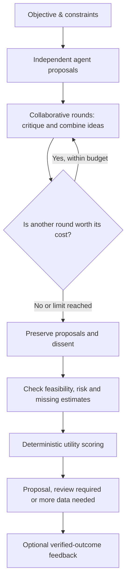

# Arbiter AI

### Think together. Disagree intelligently. Decide systematically.

**An open-source, domain-neutral decision layer for multi-agent AI.**

Arbiter AI helps AI agents **brainstorm independently, challenge one another, generate new solutions, and preserve legitimate disagreements**. A separate, transparent decision engine then evaluates the proposed options against utility, cost, risk, and missing information—**without giving a single “judge” model the final say**.

> **中文版简介：** Arbiter AI 是一个通用多智能体协作与决策插件。多个 Agent 可以先独立思考，再互相质疑、创造新的候选方案，最后保留不同意见，由独立评分引擎在成本、风险与信息约束下评估方案，而不是强制投票达成共识。

**Current release:** Collaborative v0.3 · Research MVP · Python 3.11+ · MIT


## Why Arbiter AI?

Most multi-agent demos end in voting or ask another LLM to act as a final judge. Arbiter AI takes a different approach:

- **Generate, don't just vote.** Agents can propose solutions that were absent from the original choice set.
- **Preserve dissent.** Support, opposition, critiques, and unresolved concerns remain visible in the output.
- **Separate deliberation from decisions.** AI models propose and debate; deterministic rules score eligible options.
- **Account for limits.** Cost, risk, budgets, missing estimates, and a host-supplied estimate of further discussion value influence when to stop.
- **Make the process inspectable.** Record round-by-round transcripts, proposal lineage, scores, and review requirements.

This library is intended to be used **inside** other AI applications, not to replace their prompts, tools, data sources, or execution/authorization systems.

## How it works



**Important:** An agent may remain opposed to the highest-scoring proposal. The system does not erase that opposition or automatically execute any action.

## Features

| Capability | What v0.3 provides |
|---|---|
| Independent thinking | Agents contribute before seeing their peers' first-round answers |
| Collaborative brainstorming | Subsequent rounds can critique, revise, and introduce new proposals |
| Proposal lineage | New proposals may reference parent ideas |
| Disagreement preservation | Structured support, opposition, critiques, and full round traces |
| Decision scoring | Comparable expected utility − execution cost − risk penalty |
| Cost-aware stopping | Discussion rounds, novelty plateau, budget checks, optional externally supplied information-value estimates |
| SDK / integrations | Python SDK, optional MCP tools, local REST endpoints, LiteLLM adapter |
| Feedback and evaluation | SQLite-based **verified** feedback; synthetic tests and benchmark examples |

No stock-specific or other industry-specific rules are built into the core. Host applications supply domain knowledge, candidates, estimates, policy, and authorization.

## Quick start

Clone/download this repository, enter its root, then install in a Python 3.11+ environment:

```bash
python -m pip install -e ".[dev]"
python -m examples.collaborative_demo
python -m benchmarks.run_collaboration_benchmark
python -m pytest
```

On Windows you can use `py -3.12 -m venv .venv` and `.venv\Scripts\Activate.ps1` first. For macOS/Linux, use `python3 -m venv .venv` and `source .venv/bin/activate`.

The default example is **scripted and offline**. It uses no API key and incurs no LLM charges.

### Interactive browser demo

Open [`docs/index.html`](docs/index.html) in your browser. The standalone interactive page demonstrates:

- Independent proposals and a new hybrid proposal in later rounds
- Agent support/opposition that does **not** have to converge
- Real-time changes in option rankings when costs change
- An explicit “needs estimates” gate for options with unknown costs

The browser demo is a **scripted visualization**, not a live multi-model session. It can be published with GitHub Pages by serving the `/docs` folder.

## Use as a Python library

```python
import asyncio
from arbiter_plugin import (
    BrainstormRequest,
    Contribution,
    IdeaDraft,
    Position,
    ScriptedBrainstormAgent,
    run_brainstorm,
)

agent_a = ScriptedBrainstormAgent(
    agent_id="speed",
    independent=Contribution(
        agent_id="speed",
        new_ideas=[IdeaDraft(
            id="fast", title="Fast release", description="Ship a small pilot",
            expected_utility=80, execution_cost=15, risk_loss=10,
            feasible=True,
        )],
        position=Position(support_ids=["fast"]),
    ),
)

agent_b = ScriptedBrainstormAgent(
    agent_id="quality",
    independent=Contribution(
        agent_id="quality",
        new_ideas=[IdeaDraft(
            id="careful", title="Careful release", description="Validate before launch",
            expected_utility=90, execution_cost=30, risk_loss=8,
            feasible=True,
        )],
        position=Position(support_ids=["careful"]),
    ),
)

request = BrainstormRequest(
    session_id="release-plan",
    objective="Choose a software delivery approach",
    max_discussion_rounds=0,
)

result = asyncio.run(run_brainstorm(request, [agent_a, agent_b]))
print(result.selected_idea_id)
print(result.dissents)
print(result.model_dump_json(indent=2))
```

For the **full multiple-round demonstration that generates a third idea**, run [`examples/collaborative_demo.py`](examples/collaborative_demo.py).

## Scoring and decision boundaries

For proposals with complete, comparable inputs:

```text
net_utility = expected_utility - execution_cost - risk_aversion * risk_loss
```

All terms must share a consistent **utility unit**. An agent's numbers are estimates, **not verified facts**. If a proposal lacks utility, cost, risk, or feasibility estimates, Arbiter leaves it unscored and blocks an unconditional final selection.

A review may also be required for risk warnings, policy settings, or API-budget overrun. **Arbiter proposes; it does not execute external actions.**

A further brainstorming round can be skipped if the *externally estimated* decision improvement does not exceed the *externally estimated* deliberation cost. This is not an automatically learned or scientifically calibrated value-of-information model.

## Optional integrations

| Integration | Install | Entry point |
|---|---|---|
| Real LLM agents (LiteLLM) | `pip install -e ".[llm]"` | `python -m examples.live_brainstorm` |
| Local HTTP API | `pip install -e ".[api]"` | `uvicorn arbiter_plugin.api:app --host 127.0.0.1 --port 8000` |
| MCP tools | `pip install -e ".[mcp]"` | `python -m arbiter_plugin.mcp_server` |

The HTTP interface includes `/v1/brainstorm`, `/v1/evaluate`, and `/v1/research`. The brainstorming endpoint **consolidates host-submitted transcripts**; it does not itself run the models. MCP exposes `arbiter_brainstorm`, `arbiter_evaluate`, `arbiter_plan_research`, and `arbiter_record_verified_outcome`.

The localhost HTTP example **has no authentication**; do not expose it publicly. MCP host compatibility and live paid-provider calls have **not** been independently verified end-to-end for this release. API spending limits are estimates, not hard limits enforced by providers.

## Evaluation: what is and isn't proven

The repository includes deterministic Python tests and five synthetic collaboration checks. They verify code paths and contracts. **They do not prove that multi-agent deliberation outperforms a single LLM in real decisions.**

To evaluate that hypothesis, future experiments should compare single-agent, simple voting, and collaborative approaches on held-out tasks with the **same budget**, human-verified ground truth, real costs, solution novelty, calibration, and failure/review rates.

## Project structure

```text
arbiter_plugin/    # Core contracts, scoring, collaboration, feedback, adapters
examples/          # Offline and optional live demos
benchmarks/        # Synthetic benchmark runner and sample tasks
tests/             # Automated unit tests
docs/              # Interactive browser demo and architecture notes
.github/workflows/ # GitHub Actions test workflow
pyproject.toml
LICENSE
```

More architectural detail: [`docs/ARCHITECTURE.md`](docs/ARCHITECTURE.md).

## Roadmap

- [x] Independent proposals, collaborative rounds, new candidate ideas
- [x] Persistent dissent and transparent decision scoring
- [x] Python SDK, offline web demo, optional MCP/HTTP adapters
- [ ] Semantic idea deduplication and evidence provenance checks
- [ ] Real-model cross-provider evaluation and calibrated uncertainty
- [ ] Robust public deployment, authentication and operational observability
- [ ] Empirical, cross-domain value-of-information estimation

## Project status and limitations

**v0.3 is a research MVP, not a production decision authority.** Agents can share errors or invent evidence; proposal novelty is tracked by **IDs**, not semantic equivalence; cost/utility estimates are only as good as their sources; the library does not grant permission to perform external actions. High-impact use requires independent verification, host-side safeguards and human authorization.

**License:** [MIT](LICENSE)
