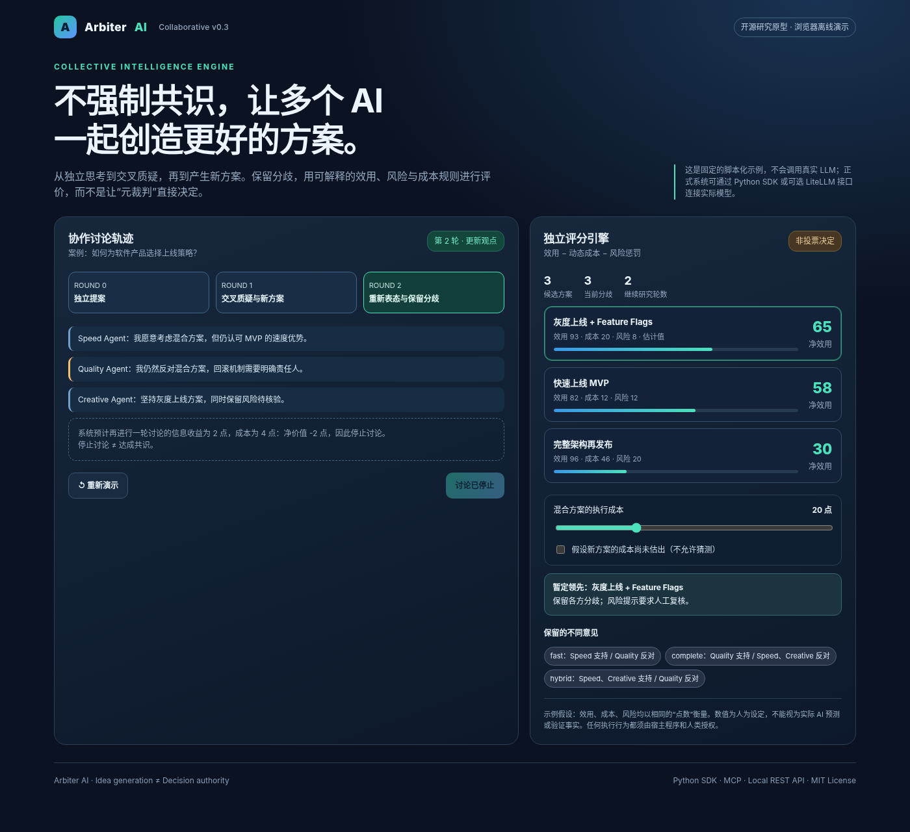

# PluralForge AI

**Better decisions under constraints.**  
**资源有限时，尽可能做出更好的决策。**

PluralForge AI is an open-source, domain-neutral **resource-constrained adaptive multi-agent decision framework**. It coordinates independent proposals, critique, synthesis, evidence gathering and optional experiments, then recommends where to spend the **next unit of decision-making effort**.

PluralForge AI 是一个开源、通用、可插拔的**资源约束下自适应多智能体决策框架**：让多个 Agent 独立提出方案、交叉质疑、组合创新，并在时间、算力、预算及风险约束下，判断**下一步应该讨论、检索、实验，还是停止**。

> **Research MVP v0.7.1** · Python 3.11+ · MIT · Offline-first  
> **Core interfaces:** Python SDK · optional local HTTP API · optional MCP · optional LiteLLM  
> **Preferred import:** pluralforge (the legacy arbiter_plugin path remains supported)

## 1. What problems does it solve? / 产品能解决什么问题？

These four problems commonly arise in architecture selection, technical reviews and complex decisions where time, information and compute are limited.  
在架构选型、技术评审及其他复杂决策中，企业经常面临以下四类问题：

1. **避免“只投票、不形成更优选项” / Go beyond voting to generate better alternatives**  
   实现 Agent 独立提案、交叉质疑、组合创新与分歧保留，输出可比较的候选方案和讨论依据，适用于架构选型及复杂方案评审。  
   *Agents independently propose, challenge and synthesize alternatives. The system preserves dissent and returns comparable options with an auditable rationale instead of treating majority voting as a final answer.*

2. **减少“重复讨论却不知何时停止” / Know when more discussion is worth the cost**  
   基于预期信息收益、效用成本及 API 预算，推荐继续讨论、单独咨询、检索或停止；再将经批准的实验纳入下一步价值比较，避免无依据地增加调用。  
   *Compare marginal information value, utility cost and API budget to recommend further discussion, targeted consultation, evidence retrieval or stopping. Host-approved experiments can also be compared as an optional next step.*

3. **解决“信息散落、无法追溯和复用” / Make evidence and decisions traceable and reusable**  
   利用 SQLite 共享黑板、版本化状态、事件订阅及历史反馈记录，让 Agent 围绕新证据协作，同时保留来源、反对意见和核验状态。  
   *A SQLite shared blackboard, versioned state, event subscriptions and feedback records help agents respond to new information while retaining provenance, opposing views and verification status.*

4. **补足“方案难验证”的环节 / Provide a path from proposals to testable evidence**  
   提供可选 Docker 受限 Benchmark 执行、结果回写与风险边界；交付 Python SDK、离线示例和自动化测试（GitHub Actions Python 3.11/3.12 通过）。研究 MVP，尚未证明真实场景中的效率提升。  
   *An optional constrained Docker benchmark runner records results and notifies other agents. The research MVP includes a Python SDK, offline demos and automated CI tests on Python 3.11/3.12; real-world productivity or decision-quality improvements have **not** yet been established.*

**In one sentence / 一句话总结：** PluralForge AI helps teams **choose better options and decide which additional work is worth doing** under limited resources.  
PluralForge AI 关注的不是让 AI 讨论得更多，而是**让团队在有限资源下比较方案、验证关键假设，并判断何时应该停止投入**。

### The two decision questions / 两层决策问题

More agents, more tokens and longer debates do not automatically produce better decisions.

Given incomplete information, multiple feasible options and limited resources, we want to answer **two different questions**:

1. **Which option looks best? / 哪个方案更好？** Compare expected utility, execution cost, risk and feasibility; allow new options and unresolved disagreement.
2. **What should we do next to improve the decision? / 还值得做什么？** Compare the *expected marginal value* of asking another agent, discussing, retrieving evidence, running an approved experiment or stopping.

The objective is not agreement, maximized token usage or a mathematically guaranteed global optimum. It is to improve **expected decision quality per unit of cost**, while remaining honest about missing evidence and uncertainty.

目标不是强制共识，也不保证找到数学意义的全局最优解；目标是在可验证证据与明确资源限制下，提高**单位决策成本产生的预期价值**。

## 2. Core principles / 核心原则

- **Independent first / 先独立思考：** Agents propose independently before seeing peers' ideas.
- **Create, don't just vote / 允许创造新方案：** Critique and synthesis can generate additional candidate ideas with parent references.
- **Preserve dissent / 保留分歧：** Opposing positions remain visible in the results and audit trail.
- **Value of information / 信息价值：** Further work needs an explicit or historically estimated marginal benefit greater than its comparable utility cost.
- **Separate units / 不混淆单位：** Decision utility and USD API/experiment budgets are tracked independently.
- **Evidence before confidence / 证据优先：** Agent estimates, retrieved information and benchmark reports are not automatically verified truths.
- **Recommend, don't secretly act / 建议而非越权执行：** Sensitive actions remain under host/human control.

## 3. Architecture / 架构

~~~mermaid
flowchart TD
    H["Host: objectives, constraints, budgets"] --> I["Round 0: independent Agent proposals"]
    I --> C["Ideas, critiques, synthesis, dissent"]
    C --> R["Adaptive information-value router"]
    L["SQLite verified-outcome learner"] -. "historical forecasts" .-> R
    P["Explicit host assumptions"] -. "optional forecasts" .-> R
    R --> A["Consult one Agent / Discuss all / Retrieve / Stop"]
    A --> C
    C --> S["Deterministic utility, risk & feasibility scoring"]
    S --> O["Proposals, rankings, dissent, audit trace"]
    O -. "independently verified later" .-> L

    H --> B["Optional shared blackboard: state + events"]
    B --> E["Optional bounded event workers"]
    E --> B

    H --> U["Optional unified next-step advisor"]
    R -. "compatible forecasts" .-> U
    U --> X["Approved experiment recommendation"]
    X -. "host explicitly invokes" .-> D["Restricted Docker benchmark runner"]
    D --> F["Unverified result + benchmark.completed event"]
    F --> B
~~~

**Important scope boundary / 重要边界：** The main run_brainstorm orchestration handles agent discussion and retrieval; it does **not** automatically execute experiments. The unified experiment advisor, blackboard and sandbox runner are **separate, opt-in components** integrated by a trusted host.

## 4. What's implemented in v0.7.1 / 当前已实现

| Component | Current capability | Limitation |
| --- | --- | --- |
| Multi-agent brainstorming | Independent proposals, critiques, synthesis and idea ancestry | Live LLM calls require explicit adapter configuration |
| Dissent & scoring | Preserve conflicting positions; deterministic utility-cost-risk comparison | Missing comparable estimates can block final selection |
| Adaptive routing | Recommend consult_agent, discuss_all, retrieve or stop | Forecasts are assumptions or observational estimates, not guaranteed gains |
| Information Value Learning | SQLite, externally confirmed outcomes, as-of cutoff and conservative historical forecasts | Not a causal value-of-information estimator; sparse data abstains |
| Shared Blackboard (v0.6) | Versioned SQLite artifacts, workspace separation, append-only events and durable consumer offsets | Host starts event workers; no continuous daemon or built-in authorization |
| Experiment Runner (v0.7) | Opt-in Docker-based Python benchmark execution with resource restrictions | Requires host-approved benchmark, Docker and appropriate dedicated isolation |
| Unified Advisor (v0.7.1) | Compare discussion, retrieval, experiments and stopping using explicit forecasts | Never runs code automatically; experiments must be approved |
| Interfaces & audits | Python SDK, optional local API/MCP and traceable outputs | Not a production multi-tenant API service |

### Decision model / 决策模型

For complete, comparable host-specified utility estimates, a candidate is scored using:

~~~text
net_utility = expected_utility - execution_cost
              - risk_aversion * risk_loss
~~~

**Expected utility, execution cost and risk loss must use the same declared utility unit.** USD API charges are a **separate spending constraint**. The router compares the expected improvement of a next step with its marginal utility cost and can recommend stopping.

These scores are only as reliable as the estimates and evidence supplied to the system. **A highest-scored candidate is not proof of global optimality.**

## 5. Quick start / 快速开始

Python **3.11+** is required. The default examples are scripted/offline and do not make paid model calls.

~~~bash
git clone https://github.com/ZacharyVo/PluralForge-AI.git
cd PluralForge-AI
python -m venv .venv
# Windows PowerShell: .venv\Scripts\Activate.ps1
# Linux / macOS: source .venv/bin/activate
python -m pip install -e ".[dev]"

python -m examples.collaborative_demo
python -m examples.adaptive_demo
python -m examples.value_learning_demo
python -m examples.blackboard_demo
python -m benchmarks.compare_policies
python -m pytest
~~~

If using the v0.7.1 source ZIP, extract it and run the commands **inside the extracted repository**, skipping the git clone step.

### Example A: decide whether to keep discussing

~~~python
from pluralforge import NextActionEstimate, select_next_action

plan = select_next_action(
    [
        NextActionEstimate(
            action="consult_agent", agent_id="critic",
            expected_decision_gain=8,
            execution_cost_utility=2,
            estimated_api_cost_usd=0.02,
            rationale="Explicit host estimate",
        ),
        NextActionEstimate(
            action="retrieve",
            expected_decision_gain=5,
            execution_cost_utility=2,
            estimated_api_cost_usd=0.01,
            rationale="Explicit host estimate",
        ),
    ],
    remaining_api_budget_usd=0.05,
    reservations_usd={"critic": 0.02},
    retriever_available=True,
)
print(plan.action, plan.reason)
~~~

### Example B: compare additional thinking with an experiment

~~~python
from pluralforge import ExperimentEstimate, select_research_or_experiment

experiment = ExperimentEstimate(
    experiment_id="test-router-001",
    expected_decision_gain=10,
    execution_cost_utility=3,
    estimated_execution_cost_usd=0.10,
    rationale="Hypothesis supplied by the host (not verified)",
    candidate_ref="git:example-commit",
    benchmark_ref="benchmark:approved-suite",
)

recommendation = select_research_or_experiment(
    forecasts=[],  # May include existing host or learner forecasts
    experiments=[experiment],
    remaining_api_budget_usd=0.05,
    remaining_experiment_budget_usd=0.50,
    reservations_usd={},
    experiment_runner_available=True,
    human_approved_experiments=frozenset({"test-router-001"}),
)
print(recommendation.action, recommendation.target_id)
~~~

**This produces a recommendation, not an automatic code execution.** The trusted host must separately approve and invoke DockerExperimentRunner.

### Example C: share work through environment changes

~~~python
from pluralforge import SharedBlackboard

board = SharedBlackboard("workspace.sqlite", space="research-project")
board.put("proposal:1", "idea", {"hypothesis": "test a new router"},
          actor="explorer", expected_version=0)
board.publish("benchmark.completed",
              {"candidate": "proposal:1", "score": 0.73},
              actor="tester", dedupe_key="benchmark/run-001")
print(board.poll("critic", kinds=("benchmark.completed",)))
~~~

A subscriber can consume the event, write a critique and acknowledge the event. All new claims remain unverified until checked by a trusted host.

## 6. Where the code lives / 主要代码位置

| Module | Responsibility |
| --- | --- |
| arbiter_plugin/collaboration.py | Brainstorm orchestration, idea lineage, critiques and disagreement |
| arbiter_plugin/adaptive.py | Value-aware next-step selection among discussion/retrieval |
| arbiter_plugin/value_learning.py | Historical, verified-feedback-based forecasting |
| arbiter_plugin/blackboard.py | Shared state, events, version checks and durable cursors |
| arbiter_plugin/experiments.py | Opt-in Docker runner and experiment feedback |
| arbiter_plugin/experiment_routing.py | Advisory unified experiment/agent/retrieval/stop routing |
| arbiter_plugin/api.py | Optional local HTTP adapter |
| arbiter_plugin/mcp_server.py | Optional MCP integration |
| benchmarks/ | Synthetic/offline comparison and evaluation scripts |
| tests/ | Automated regression tests |

The public import path is pluralforge, with arbiter_plugin kept for backwards compatibility.

## 7. Evaluation & honest limitations / 评测与边界

Included scripted and synthetic benchmarks help test **interfaces, accounting, reproducibility and policies**, but they do not establish production-level superiority against other AI systems or real-world decision outcomes. A genuine effectiveness evaluation requires representative tasks, ground-truth/rubric quality checks, fair baselines, controlled budgets and confidence intervals.

- **No claimed global optimum / 不承诺全局最优：** Unknown options and uncertain payoff estimates remain limitations.
- **No self-certification / 不允许自证：** Agent claims, benchmark output and retrieved content require independent checks.
- **No forced final judge / 无独裁元裁判：** Deterministic scoring does not erase disagreement or authorize execution.
- **No autonomous production deployment / 不自动部署：** Code execution is opt-in, approved and isolated; no automatic merge.
- **Sandbox isn't infallible / 隔离非绝对安全：** Docker restrictions reduce risk but are not a complete hostile-code security guarantee. Use dedicated isolated infrastructure.
- **Not production-authenticated / 非多租户生产服务：** SQLite board verification is a trusted-host convention, not access control.
- **Cost estimates are not billing hard caps / 成本估计非硬限额：** External provider and host controls remain necessary.

## 8. Documentation / 文档

- [Shared Environment / 共享环境](docs/SHARED_ENVIRONMENT.md)
- [Controlled Experiments / 隔离实验](docs/EXPERIMENTS.md)
- [Unified Routing / 统一下一步路由](docs/EXPERIMENT_ROUTING.md)
- [Information Value Learning / 信息价值学习引擎](docs/INFORMATION_VALUE_LEARNING.md)
- [Architecture / 架构说明](docs/ARCHITECTURE.md)
- [Benchmark Protocol / 评测方案](docs/BENCHMARK_PROTOCOL.md)
- [中文快速开始](START_HERE_中文.md)
- [Changelog](CHANGELOG.md)

**License: MIT.** Contributions are welcome when they include reproducible test cases and explicit evidence boundaries.

---

**PluralForge AI — Many minds, better choices, fewer wasted steps.**  
**多元思考、可验证决策、减少无效计算。**
