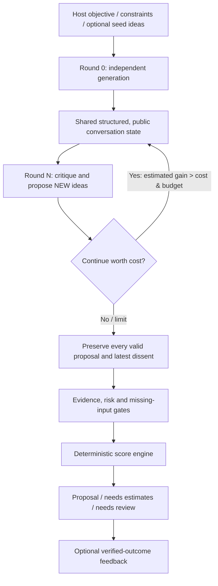

# Collaborative Architecture · v0.3

## Why this isn't a meta-judge

- The engine does not ask an LLM which response wins.
- Each independent agent sees only the host's seed ideas before initial submission.
- Later rounds see the previous round's ideas, public critiques and stances. Agents may propose brand-new options, including combinations with parent IDs.
- The latest support/oppose positions are preserved. They do **not** have to converge.
- A deterministic scorer recommends among fully specified and feasible options. Unscored options block unconditional final selection. Risk warnings require review.
- External feedback can update historical reliability but does not overwrite a discussion transcript or resolve disagreements by fiat.

## Core data flow

`BrainstormRequest` → `DiscussionView` → `Contribution` (new ideas, critiques, stance, cost) → `RoundTrace` → `consolidate_brainstorm` → `BrainstormResult`.

External applications can use `consolidate_brainstorm` without sending provider data to this package: they run their own agents and pass a signed/curated transcript. The optional `run_brainstorm()` Asyncio orchestrator calls `.propose()` and `.discuss()` implementations for each agent in parallel. It validates and records the outputs; an invalid agent contribution cannot erase valid peers' ideas.

## Independent status vs scores

`IdeaDraft` utility numbers are **estimates**, not facts. Three fields plus explicit feasibility must be supplied to score: expected_utility, execution_cost, risk_loss, feasible. A new idea missing any field is left in `unscored_ids`, and `selected_idea_id` stays `null` until the gap is resolved. The scorer can still return a `provisional_leader_id` for the evaluated subset.

All numeric units must be commensurate. In `points` mode, user-provided execution cost and risk loss must be calibrated into points, not raw USD.

## Stopping policy

1. `max_discussion_rounds` and `max_total_ideas` are hard **structural** limits.
2. `stop_after_no_new_rounds` controls plateau stopping; generating no novel ideas is only a heuristic (new evidence or critique can still matter).
3. When supplied, round-specific information value `expected_decision_gain` must exceed `discussion_cost_utility` **in the same utility unit**. These are external estimates, not computed from entropy.
4. Reserved API spend is checked before each parallel batch, **but is only a preflight estimate**; provider billing may exceed it. Actual reported cost overruns stop further rounds and require review. Use provider quotas for enforcement.

## Trust and security boundaries

- The engine cannot verify external claims, costs, the origin of data, or the truth of model-generated arguments.
- Model responses are untrusted. Invalid/duplicate IDs, nonexistent references, fabricated "verified" values, and cyclical ancestry are rejected.
- Never execute an external action from a proposed option without host-side authorization.
- Offline SDK works without network. A configured LiteLLM provider will receive objectives and argument data; do not send secrets without consent.
- MCP and HTTP adapters are separate. The HTTP demo listens on localhost only and has no authentication; it is not suitable for public deployment.
- No semantic deduplication in v0.3: structurally unique but substantively equivalent proposals can exist, and novelty is based on IDs. Future work: similarity + provenance-aware review, without silently merging dissent.
- No causal reinforcement-learning result is claimed. Offline synthetic contract tests only prove code behavior, not improved model reasoning or objective decision quality.
