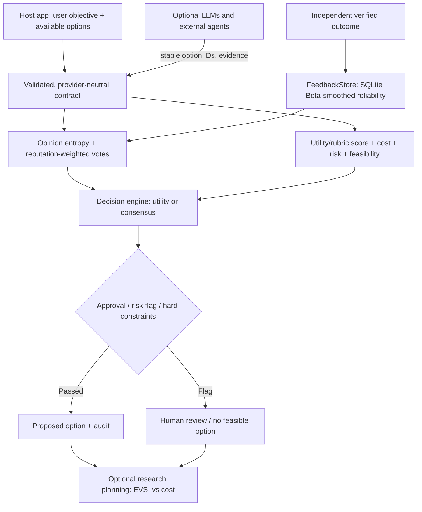

# Arbiter AI Universal · Decision Plugin

> **A provider-neutral, domain-neutral decision and evaluation plugin for AI agents.**
>
> 通用 AI 决策中间件：多智能体意见聚合、可解释评分、成本和风险约束、研究信息价值、可信反馈与可复现实验。

**Status:** v0.2.0 research MVP · Python 3.11+ · MIT · runs offline · optional MCP / REST / LiteLLM

**This is a reusable plugin/library, not a stock-picking bot, finance adviser, automatic trading system, or pre-registered ChatGPT plugin.** It never executes the proposed real-world action.

## Why this exists / 定位

Most multi-agent demos let three LLMs vote and call the result “decision intelligence.” Arbiter makes the decision policy **explicit, inspectable and testable**. It accepts **a task, a set of stable option IDs, optional multi-agent opinions, measured or estimated values, costs and constraints**, then returns a proposal and an audit trail.

Possible applications: software release choices, research planning, educational curricula, procurement comparisons, project priorities, generic AI assistance, and domain-specific systems built *outside* this package.

It does **not** hardcode BUY3, any stock indicator, a model vendor, a prompt framework, or a scoring rubric.




### Why Peer Brainstorming over Top-Down Meta-Judging?
Instead of a single, opaque "meta-judge" model unilaterally ruling on divergent outputs (which creates a bottleneck and misses peer blind spots), Arbiter supports **Multi-Agent Peer Brainstorming (`brainstorm_round`)**:
1. **Round 1 (Independent Divergence):** Agents generate independent hypotheses and evidence.
2. **Round N (Peer Cross-Examination):** All agent rationales are pooled and shared anonymously. Agents review counterarguments, critique logical flaws, and can actively **change their mind** or reinforce their stance.
3. **Emergent Consensus:** Disagreement entropy naturally declines as solid evidence prevails, followed by deterministic scoring.

## Supported integration surfaces / 三种接入形式

| Interface | Call style | Provider account required? | Status |
|---|---|---:|---|
| **Python SDK** | `evaluate_decision(...)` | No | Implemented and unit-tested |
| **MCP server** | `arbiter_evaluate`, `arbiter_plan_research`, `arbiter_record_verified_outcome` | No for local rules | Code written for official MCP Python SDK **v2**; requires separate installation and host integration validation |
| **HTTP API** | `/v1/evaluate`, `/v1/research` | No, local only | FastAPI routes implemented; NOT production-authenticated |
| **LLM input adapter** | `ask_parallel(...)` with LiteLLM model IDs | **Yes**, for live models | Mocked in unit tests; real paid-provider path not yet live-verified |

> MCP is an interoperability protocol, not automatic publication in ChatGPT's plugin catalog. A public multi-tenant plugin needs hosted infrastructure, auth, privacy and approval flows, plus platform-specific submission requirements.

## Windows 11 / VS Code quick start

```powershell
cd arbiter-ai-universal
py -3.12 -m venv .venv
.venv\Scripts\Activate.ps1
python -m pip install -e ".[dev]"
python -m arbiter_plugin
python -m examples.three_domains
python -m benchmarks.run_benchmark
python -m pytest
```

No external calls; safe offline demonstrations.

## 1. Python SDK: any task / 通用决策接口

```python
from arbiter_plugin import DecisionRequest, Option, Opinion, evaluate_decision

request = DecisionRequest(
    decision_id="choose-release-v1",
    objective="Choose software delivery strategy",
    domain="software",
    utility_unit="points",  # all benefits/costs/risk penalties use SAME units
    risk_aversion=1.0,
    mode="utility",  # alternatively "consensus"
    options=[
        Option(id="mvp", expected_utility=80, execution_cost=10, risk_loss=5),
        Option(id="rewrite", expected_utility=95, execution_cost=35, risk_loss=20),
    ],
    opinions=[
        Opinion(agent_id="model_a", option_id="mvp", rationale="Iterate sooner"),
        Opinion(agent_id="model_b", option_id="rewrite", confidence=.9,
                confidence_source="self_report"),
    ],
)
result = evaluate_decision(request)
print(result.selected_option_id, result.status)
# mvp proposed
print(result.model_dump_json(indent=2))
```

**Utility mode:** `net = expected_utility − execution_cost − risk_aversion × risk_loss`. Feasibility (hard constraints) is evaluated **before** proposing an option. The numeric inputs are provided by the *host application or independently justified estimators*, not invented by Arbiter. If costs and benefits cannot be normalized into comparable units, the result is not meaningful; use `consensus` mode or supply a coherent rubric.

**Consensus mode:** votes are weighted by historical domain-specific reliability; *only independently calibrated* confidence may modify a vote. Uncalibrated model self-confidence never claims predictive accuracy. Equal vote counts are resolved deterministically by net utility then option ID.

**Rubric scoring:** provide `criterion_weights={"quality":2,"speed":1}` and each option's `criterion_scores={"quality":80,"speed":90}`, values in `[0,100]`. The weighted score is computed only from provided data. Execution cost and risk penalties must be converted to **rubric points** when using this mode; don't subtract USD from points.

**Business-specific extension hooks:**

```python
result = evaluate_decision(
    request,
    utility_fn=lambda req, option: custom_estimated_utility(req, option),
    feasibility_fn=lambda req, option: domain_specific_policy(req, option)
)
```

A finance, medical, procurement or robotics application supplies its own models and policies externally; `arbiter_plugin` remains unchanged. Hooks run in the local Python SDK (not accepted as remote executable code over MCP or HTTP).

## 2. Value of information / 信息价值

```python
from arbiter_plugin import ResearchRequest, ResearchOption, plan_information

plan = plan_information(ResearchRequest(
    decision_id="choose-release-v1", utility_unit="points",
    max_api_budget_usd=0.05, api_spent_usd=0.01,
    opportunities=[
      ResearchOption(id="test_users", expected_information_gain=12,
                     research_cost_utility=4, estimated_api_cost_usd=.02),
      ResearchOption(id="ask_3_more_models", expected_information_gain=3,
                     research_cost_utility=5, estimated_api_cost_usd=.03)
    ]
))
print(plan.action, plan.recommended_research_id)
# research test_users
```

`EVSI − cost` must use the **same utility units**. API dollar spend is tracked separately as a feasibility cap; the library does not magically derive EVSI from answer disagreement or claim a hard API spending guarantee. No actual research tool is invoked by this method.

## 3. Evidence-gated feedback / 真实反馈

```python
from arbiter_plugin import FeedbackStore, VerifiedOutcome, Opinion

store = FeedbackStore("local-feedback.sqlite")
receipt = store.record(VerifiedOutcome(
    decision_id="historical-case-001", domain="software",
    ground_truth_option_id="mvp", verified=True,
    verification_source="human-reviewed-acceptance-test-001",
    opinions=[Opinion(agent_id="model_a", option_id="mvp"),
              Opinion(agent_id="model_b", option_id="rewrite")]
))
print(receipt.reliability)
# model_a: 2/3, model_b: 1/3
```

Verified feedback requires an explicitly supplied source; the plugin **does not independently verify that source**. Recordings are idempotent by `(decision_id, agent_id)`, and conflicting labels are refused. Only option labels, domain, IDs and verification sources are stored in local SQLite; original user prompts and model private reasoning are not stored. This is **not** reinforcement learning: a Beta(1,1)-smoothed historical correctness score is used for reputation.

## 4. MCP plugin for supported AI clients / MCP 通用插件

The MCP adapter follows the **official Python SDK v2**. See [Python SDK](https://py.sdk.modelcontextprotocol.io/) and [running a server](https://py.sdk.modelcontextprotocol.io/run/).

```powershell
python -m pip install -e ".[mcp]"
python -m arbiter_plugin.mcp_server
```

The server now waits for a compatible MCP host on **stdio**; a blank terminal is normal. Install the server into a compatible IDE/agent using the Python interpreter for this environment. Example host configuration (adjust the absolute path):

```json
{
  "mcpServers": {
    "arbiter-ai": {
      "command": "C:\\ABSOLUTE\\PATH\\arbiter-ai-universal\\.venv\\Scripts\\python.exe",
      "args": ["-m", "arbiter_plugin.mcp_server"],
      "env": {"ARBITER_DB": "C:\\ABSOLUTE\\PATH\\arbiter-feedback.sqlite"}
    }
  }
}
```

Client-specific configuration keys differ; adapt the above to your host. The tools are:

- `arbiter_evaluate(payload)` — validates and scores a decision.
- `arbiter_plan_research(payload)` — evaluates expected net information value.
- `arbiter_record_verified_outcome(payload, confirm_record=true)` — a local write, requiring explicit confirmation and `verified=true` with `verification_source`.

The plugin **does not** browse, trade, email, purchase, approve, deploy or execute an action for the host. The host must obtain explicit authorization for any real-world effect. The MCP SDK is not installed in the packaging environment, so protocol handshake has **not** been end-to-end tested yet; Python core tests are independent of MCP.

## 5. Optional localhost HTTP API

```powershell
python -m pip install -e ".[api]"
python -m uvicorn arbiter_plugin.api:app --host 127.0.0.1 --port 8000
```

Open `http://127.0.0.1:8000/docs` for interactive Swagger documentation. Do **not** bind the sample API to `0.0.0.0` or publish it to the Internet without authentication, authorization, rate limits, TLS and request isolation. Feedback writing is deliberately not exposed over unauthenticated HTTP.

## 6. Optional real multi-model adapter (LiteLLM)

```powershell
python -m pip install -e ".[llm]"
$env:ARBITER_MODELS = "openai/<VALID_MODEL_ID>,anthropic/<VALID_MODEL_ID>"
# Set corresponding provider API keys using OS environment variables.
python -m examples.real_models
```

Provider charges apply. The adapter forces stable option IDs and validates JSON responses. Failed requests are isolated. Any confidence returned by the model is marked **self-reported**, *not calibrated*. Estimated model cost is **not** a hard spending ceiling. Real provider calls were **not** run during package validation.

## 7. Benchmark / 回归测试

```powershell
python -m benchmarks.run_benchmark
python -m pytest
```

The included dataset contains **five synthetic, hand-authored decision expectations** for software, education, operations and risk gates, intended as regression fixtures, *not evidence of actual model accuracy*. Add externally labeled cases with provenance for real Benchmark research. For live evaluations, pin task data, prompt versions, time availability, model versions, provider costs, repeated trials and human labels.

## Layout

```text
arbiter-ai-universal/
├── arbiter_plugin/
│   ├── models.py          # Pydantic input/output contracts
│   ├── core.py            # Opinion aggregation, deterministic scoring, policies
│   ├── information.py     # EVSI-aware research-step planning
│   ├── feedback.py        # Verified-feedback SQLite store
│   ├── benchmark.py       # Offline regression benchmark
│   ├── llm_adapters.py    # Optional multi-provider LiteLLM input
│   ├── mcp_server.py      # Optional MCP v2 plugin adapter
│   └── api.py             # Optional FastAPI local interface
├── examples/              # Offline demo + optional real-model demo
├── benchmarks/            # Synthetic cross-domain regression fixtures
├── tests/                 # pytest unit tests
├── docs/ARCHITECTURE.md
├── .github/workflows/tests.yml
├── pyproject.toml
└── LICENSE
```

## Scope and limitations

- Option IDs are **structured, canonical references**, so semantically equivalent text labels must be mapped by the calling application. No hidden BUY3 or finance-specific answer normalization remains.
- “Disagreement entropy” measures response diversity, **not** objective uncertainty or correctness probability. Correlated models can agree and all be wrong.
- Net-value scores are conditional on externally supplied utilities, cost estimates and risk assumptions. The plugin cannot infer these as ground truth.
- Input and prompt text may be sensitive; local code does not transmit it, but the optional LiteLLM adapter sends objective and option descriptions to whichever provider you explicitly configure.
- Results are **recommendations only**. Review gates must be enforced by the host. In high-stakes applications, use domain experts, tests and approved execution systems.
- Real MCP-host integration and live provider calls require separately installed dependencies and have not yet been end-to-end tested.

## Roadmap

- v0.3: Domain-specific adapters *outside* core; authenticated remote MCP, tracing and per-user stores.
- v0.4: Calibrated probabilities, external evidence evaluators and human-label workflows.
- v0.5: Contextual reliability, policy regression, distribution shift and causal/counterfactual assessment.

MIT License. Open-source research/demo project; no connection or publication to a public plugin store is implied.
