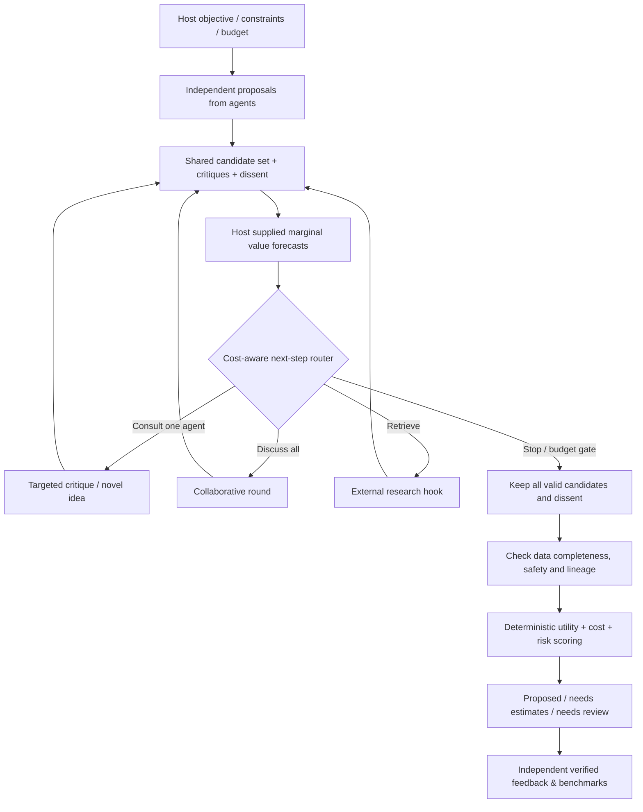

# PluralForge AI — v0.5 Architecture

## What this layer does

A host application supplies a user objective, domain, budget, risk preferences and optional seed ideas. Independent model agents produce proposals. The collaborative engine circulates **public** proposals and critiques, allows wholly new options, and preserves dissent. The next-step router estimates *whether another action is worth its cost*. A deterministic scorer evaluates viable, fully specified options. Results are **recommendations only**.

## Next action policy

For each candidate action `a`, the *host* estimates:

- `expected_decision_gain[a]`: expected improvement in the quality of the eventual decision, measured in the task's utility unit.
- `execution_cost_utility[a]`: extra discussion, retrieval, and delay cost, converted into the **same** utility unit.
- `estimated_api_cost_usd[a]`: API cash charge used **only** as a budget feasibility condition.

`net_information_value[a] = expected_decision_gain[a] - execution_cost_utility[a]`.

After filtering actions lacking the required agent/retriever and actions whose **maximum** of external estimated API charge and agent preflight reservations exceeds remaining dollar budget, choose the largest positive net value. Otherwise return `stop`. No automatically calibrated VoI is assumed. USD and utility points are never subtracted directly.

This is a **myopic, one-step policy**. It does not solve a full POMDP or guarantee globally optimal action choices. Forecast quality is part of the host's responsibility and should be benchmarked separately.

## Discussion rules

- Round 0 is a parallel independent response phase; peers do not see each other's initial answers.
- Later rounds can contact one or all agents. Each participant sees the consolidated earlier rounds and any recorded retrieval observations.
- Agents may introduce candidates, assign `parent_ids` for lineage, critique visible candidates, and support or oppose them. They are never forced to change their opinions.
- `ResearchObservation` records source and whether the host says it checked the evidence; source existence alone does not establish truth.
- Incomplete/new proposals block an unconditional selection. They are displayed rather than discarded.
- Untrusted or malformed agent contributions are rejected individually; reported paid API costs remain counted even if their output is rejected.
- `novelty_flags` are conservative **surface-form** warnings, not semantic equivalence proofs. Similar-looking proposals are not merged.

## Decision engine

For feasible candidates with complete and comparable host/agent-supplied estimates:

`net_utility = expected_utility - execution_cost - risk_aversion * risk_loss`.

The scorer never silently fills blanks. Risk-warning critiques and explicit review policies can require human review. It does not use number-of-votes as an authority signal and cannot execute an action.

## Boundaries

- External utility estimates may be inconsistent, biased or false; scoring is conditional on their inputs.
- Budget reservations are preflight estimates, not provider-side limits. A provider can still bill more than expected.
- v0.5 adds an **observational historical next-action estimator** (`value_learning.py`). It needs externally verified, time-available outcome scores and remains non-causal. No trained reinforcement-learning controller, external automatic truth verifier, or genuine semantic deduplication is included.
- Only use local HTTP mode for development. Before public hosting, implement authorization, authentication, transport security, quotas, privacy controls and data retention policy.
- MCP and LiteLLM are optional, not verified live-host integrations in this release.

## Information Value Learning Engine (v0.5)

Historical host-attested action records → `InformationValueLearner.forecast()` → per-action conservative estimated gain, execution cost and API cost → existing `select_next_action()` → only a recommended next step. `run_brainstorm(value_learner=...)` uses it for subsequent rounds when data supports the estimate. Uncertain/sparse predictions are omitted, not fabricated. See [INFORMATION_VALUE_LEARNING.md](INFORMATION_VALUE_LEARNING.md).
