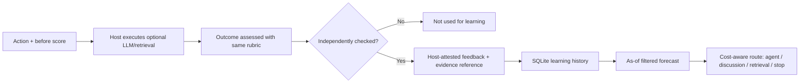

# Information Value Learning Engine (IVLE) · v0.5

## What it learns

The engine estimates **observed** changes in a host-defined, comparable *decision-quality score* following one additional action:

- `consult_agent(agent_id)`: consult a named agent
- `discuss_all`: ask all agents for another round
- `retrieve`: acquire external evidence

`stop` is always available and never requires a model call. Learning is **not** a substitute for independent verification or execution authorization.

## Data lifecycle



**Measured change:** `observed_gain = score_after - score_before`. If an extra action makes the output worse, the gain is negative. `execution_cost_utility` is in the same domain-defined utility unit; `api_cost_usd` is separately checked against the cash budget. The host must use the **same rubric and units** before and after; inconsistent scores make the output meaningless.

`available_at` is the earliest moment the outcome was known. An observation is eligible for a forecast only when `available_at < as_of`. `occurred_at` is when the action happened. These fields are host assertions, not automatically verified by the library. A historical backtest requires independently auditable evidence availability dates.

The storage API refuses unconfirmed writes and refuses conflicting duplicate IDs; exact duplicates are idempotent. `evidence_ref` stores a string reference, not a private document. Do not put secrets, names or confidential case facts into metadata or the repository.

## Learning method (transparent heuristic, **not** causal inference)

For a given action + agent, within the **same domain and utility unit**:

1. Gather eligible observations known strictly before the cutoff.
2. Assign weight `1.0` to exact categorical context matches and default `0.25` to other contexts in the same domain. Never mix utility units.
3. Require at least `3` weighted observations; otherwise abstain or use an **explicit host prior**.
4. Calculate the weighted mean observed gain; shrink it toward a zero-gain prior with strength `2.0`.
5. Compute the weighted standard error; subtract a configurable uncertainty penalty and floor the proposed gain at zero.
6. Estimate execution cost and API dollars separately from the same eligible history.
7. Pass the estimate to the existing budget-aware `select_next_action` router.

This is regularized historical averaging, not neural-network training, contextual bandits, calibrated Bayesian posteriors, or reinforcement learning. Its standard-error calculation is a **heuristic** and can underestimate uncertainty when observations are dependent. Repeated records for the same decision and action are counted at most once.

### Why no claim of causal VOI?

Only executed actions have observed outcomes. If the host calls expensive agents only on difficult tasks, average changes can be systematically different from the change that same agent would have achieved on easy tasks. We do not observe counterfactuals for actions not taken. Therefore this model estimates **observational association**, not the causal effect of consultation or a guaranteed improvement.

For serious comparisons, record action-selection propensities, deliberately randomize a safe fraction of action choices (when appropriate and authorized), run prospective A/B experiments, and assess policy value on independent held-out data. Do not assume a nice-looking simulated chart proves AI improvement.

## API quickstart

```python
from datetime import datetime, timedelta, timezone
from pluralforge import (
    LearningContext, ActionCandidate, VerifiedValueObservation,
    LearningRequest, InformationValueLearner,
)

now = datetime.now(timezone.utc)
context = LearningContext(domain='software', utility_unit='points', tags={'task':'review'})
store = InformationValueLearner('local_value_feedback.sqlite')

# Store only when a host has genuinely verified both scores and evidence.
feedback = VerifiedValueObservation(
    observation_id='case-001', decision_id='case-001', context=context,
    candidate=ActionCandidate(action='consult_agent', agent_id='reviewer'),
    score_before=60, score_after=68,
    execution_cost_utility=2, api_cost_usd=0.01,
    occurred_at=now-timedelta(days=3),
    available_at=now-timedelta(days=2),
    verifier='independent-evaluator', evidence_ref='case-log:001',
)
store.record(feedback, confirm_verified=True)

request = LearningRequest(
    context=context,
    candidates=[ActionCandidate(action='consult_agent',agent_id='reviewer')],
    as_of=now,
)
print(store.forecast(request).forecasts[0].source)  # insufficient_data (only 1 record)
```

For the full demo, run `python -m examples.value_learning_demo`. For strict chronological replay, run `python -m benchmarks.learning_temporal_replay`.

## Integration

- SDK: `InformationValueLearner.forecast()` and `.recommend()`.
- `run_brainstorm(..., value_learner=store, learning_tags=..., learning_as_of=...)` uses learned estimates automatically for later rounds **only when sufficient verified history exists**. Explicit `adaptive_forecasts` takes precedence. The initial independent round remains separate.
- Local HTTP: `POST /v1/value/record`, `POST /v1/value/forecast`, `POST /v1/value/next-step`.
- Optional MCP: `pluralforge_record_value_feedback`, `pluralforge_value_forecast`, `pluralforge_value_next_step`.

Do not expose the local FastAPI application to the public internet. It lacks production authentication, authorization, abuse prevention, privacy controls and secure tenant isolation. The recording endpoints change a local database and require `confirm_verified=true`, which is **not** a substitute for authentication or independent verification.

## What is next

- Prospective independent scoring and rubric consistency checks.
- Logged propensity / counterfactual-aware estimators, measured policy lift.
- Calibration plots and confidence intervals under dependent observations.
- Safe exploration policy with explicit budget and risk safeguards.
- Offline evaluation in multiple real task domains with fixed model versions and cost controls.
